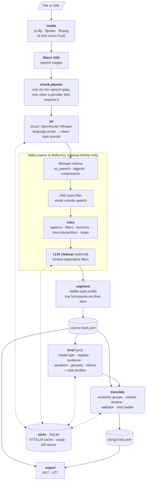

# Sub0

Local-first subtitle agent. Point it at a video file or a URL and it produces
broadcast-style subtitles in the source language and in as many target languages as
you like. It runs as a CLI and as a desktop app (Tauri 2 + React).

```text
video / URL → speech-to-text → cleanup → segmentation → localization → SRT / VTT
```

What sets it apart from "Whisper + translate":

- **Timecodes never pass through an LLM.** Models see cue ids and text only. Every
  translated track is checked against the source timing before it is written.
- **Hallucinations are removed in layers.** Silero VAD, Whisper confidence metrics,
  deterministic rules and an LLM pass each catch a different kind of noise: `*sigh*`,
  `Mm-hmm`, music-intro lyrics, repetition loops.
- **Localization, not literal translation.** In pro mode a brief describes the content
  (what kind of video it is, register, audience, speakers, idioms) and picks matching
  style profiles, so a sitcom, a news report and a gaming stream each read naturally
  in the target language.
- **Cheap to re-run.** Each stage writes its result to disk and every API response is
  cached by content hash, so re-running a job, or adding a language later, only pays
  for what is new.

## How it works



1. **Ingest.** URLs (including playlists) are downloaded with yt-dlp. The audio is
   extracted once as 16 kHz mono FLAC.
2. **Voice activity.** Silero VAD finds the speech ranges. The audio is split into
   chunks only when it exceeds a provider limit, and cuts land in gaps where nobody is
   speaking.
3. **Transcription.** When the language is set to auto, a 30 s probe from the first
   speech detects it. Whisper then gets a clean, filler-free sample in that language
   as its prompt, because it imitates the prompt's style.
4. **Cleanup.** Every layer only deletes words, never rewrites them, so the surviving
   words keep their exact timestamps. Each deletion is written to an audit file.
5. **Segmentation.** Words become cues under a reading-speed profile (characters per
   second, line length, minimum gap). Cue ids and timecodes are final from here on.
6. **Localization.** Cues are sent in batches of about 20, grouped into whole sentences
   so a sentence split across cues is translated as one unit. Pro mode adds the brief,
   its style profiles and the already-translated previous cues. A validator rejects
   echoed, missing, extra or runaway output. A batch that keeps failing falls back to
   one call per cue; a cue that still fails keeps its source text and gets a flag.
7. **Export.** SRT and VTT are written from the canonical track JSON, after the timing
   check.

The full design, including every artifact, cache key and failure mode, is in
[docs/architecture.md](./docs/architecture.md).

## Workspace layout

| Crate       | Responsibility                                                                           |
| ----------- | ---------------------------------------------------------------------------------------- |
| `core`      | `Word` / `Cue` / `Track` model, timecode invariant, job states, settings, language table |
| `media`     | ffmpeg / ffprobe / yt-dlp wrappers, Silero VAD, chunk planner                            |
| `stt`       | Groq and OpenRouter Whisper clients, hallucination defenses                              |
| `cleanup`   | deterministic rules + LLM word-index deletion                                            |
| `segment`   | cue segmentation against a subtitle profile                                              |
| `translate` | LLM provider abstraction, localization brief, batched translation + validator            |
| `export`    | SRT / VTT writers with language-aware line breaking                                      |
| `store`     | SQLite cache, usage accounting, persistent job queue                                     |
| `pipeline`  | stage orchestration (`run_file`, `run_queue`), shared by CLI and app                     |
| `cli`       | `subtitler` binary                                                                       |
| `app/`      | Tauri 2 desktop app (Rust commands + React/Vite UI)                                      |

Business logic lives in the library crates; the CLI and the app are thin wrappers
around `pipeline`.

## Getting started

Requirements: Rust (stable), [ffmpeg](https://ffmpeg.org) with `ffprobe`,
[yt-dlp](https://github.com/yt-dlp/yt-dlp) for URLs, and Node 18+ for the desktop UI.
The first build downloads a prebuilt ONNX Runtime for Silero (see
[THIRD_PARTY_NOTICES.md](./THIRD_PARTY_NOTICES.md)).

```sh
git clone https://github.com/Egv2/sub0 && cd sub0
export GROQ_API_KEY=...        # and/or OPENROUTER_API_KEY=...

cargo build --workspace

# source-language subtitles only
cargo run -p subtitler-cli -- transcribe --input video.mp4

# cleanup + German and English, pro localization (the default mode)
cargo run -p subtitler-cli -- run --input video.mp4 --cleanup --langs de,en

# a queue of files and URLs, resumable
cargo run -p subtitler-cli -- batch --inputs urls.txt --langs tr

# desktop app
cd app && tauri dev
```

Useful switches: `--mode fast|pro`, `--no-vad`, `--no-rules`, `--language <iso>`,
`--prompt "<style directives>"`. All flags are listed in
[docs/cli-reference.md](./docs/cli-reference.md).

## Customizing

Everything that shapes model behavior is a plain file under [`prompts/`](./prompts):

- `styles/*.md`: localization profiles. Each file starts with
  `<!-- when: ... -->`. To support a new kind of content, add a file; no code change
  is needed.
- `stt.<lang>.txt`: the clean-style Whisper prompt for a language.
- `cleanup.<lang>.md`, `translate.system.md`, `brief.system.md`: versioned prompts.
  Editing one invalidates exactly the cache entries that depend on it.

Per job, `brief.json` (in the job's working folder) can be edited by hand. The next
translation run uses your version without another brief call.

## Status

The core pipeline, cleanup, translation, caching, queue and desktop app all work.
Open items, such as a review pass for flagged cues, an evaluation set, more subtitle
profiles and cost reports, are tracked in GitHub issues.

## Legal

You are responsible for having the right to download and process the media you feed
into this tool. Third-party components and their licenses are listed in
[THIRD_PARTY_NOTICES.md](./THIRD_PARTY_NOTICES.md).

## License

MIT, see [LICENSE](./LICENSE).
