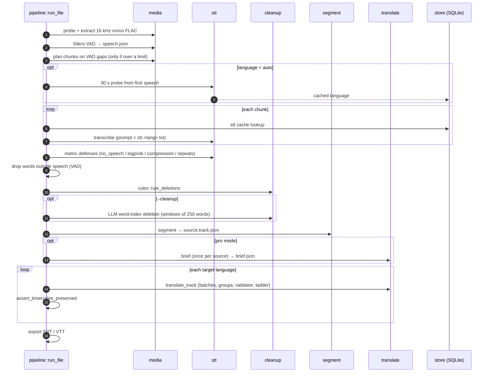
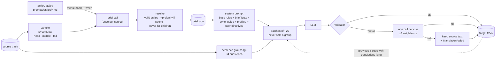

# Architecture

This document covers how a job moves through Sub0, what each stage writes to
disk, how the quality layers work together, and where caching happens. For the
flags, see [cli-reference.md](./cli-reference.md).

## Invariants

These hold after every stage, and the code is structured so they can't be broken
by accident:

1. **Timecodes never enter an LLM.** Translation and cleanup prompts carry ids and
   text only. Translated cues are rebuilt from the source cue's times, and
   `assert_timecodes_preserved` checks every track before export.
2. **Cleanup only deletes.** No stage rewrites a word, so the timestamps of the
   surviving words are the ones Whisper produced.
3. **Cue boundaries are fixed at segmentation.** Translation can move text between
   the cues of one sentence group, but it never adds, drops, merges or reorders ids.
4. **Every stage is re-entrant.** Canonical artifacts are reused when present, so
   a crashed or cancelled job resumes at the stage where it stopped.
5. **One failed job never stops the queue.**

## Pipeline



### 1. Ingest and audio

`media` wraps the only external binaries the project runs: `ffprobe`, `ffmpeg`
and `yt-dlp`. Every child process uses `kill_on_drop`, so cancelling a job never
leaves an orphaned ffmpeg. The audio is extracted once as 16 kHz mono FLAC; that
temp file is deleted as soon as `words.json` exists, even if a later stage fails.

### 2. Voice activity detection

`media::vad` streams raw f32 samples from ffmpeg into a worker thread that owns
the Silero ONNX session, so memory stays flat on multi-hour files. The output is
used twice:

- **Chunking.** If the audio exceeds the provider's size or duration limit, the
  gaps between speech ranges become cut candidates. Chunks therefore end where
  nobody is speaking, and no overlap or deduplication logic is needed.
- **Word filter.** After transcription, words that don't overlap a speech range
  (± `word_tolerance_ms`) are dropped. This removes most Whisper hallucinations
  over silence and music.

Safety valves: if the VAD fails, the pipeline falls back to ffmpeg's
`silencedetect` and skips the word filter. If the filter would drop more than 60%
of all words, it is skipped as implausible (singing, a heavy music bed).

### 3. Transcription

Groq and OpenRouter both expose Whisper behind `SttProvider`. Two provider
quirks shape the code:

- OpenRouter silently drops word timestamps on long requests, so its
  single-request cap is lower.
- Groq reports the language as a display name ("Turkish"), OpenRouter as an ISO
  code; both are normalized through `core::lang`.

Whisper imitates the style of its `prompt`. A clean, normally punctuated sample in
the right language (`prompts/stt.<lang>.txt`) suppresses fillers and sound
captions at the source. A prompt in the wrong language can push Whisper into
translating, so when the language is auto, a 30 s probe from the first speech
range detects it first.

### 4. Cleanup layers

Each layer catches what the previous one can't, and all of them only delete:

| Layer | Catches | Cost |
| --- | --- | --- |
| Whisper metrics (`stt::defenses`) | low-confidence segments, compression loops, repeated segments | free |
| VAD word filter | text over silence and music | free, local |
| Rules (`cleanup::rules`) | `*sigh*` / `[music]` captions split across tokens, symbol tokens, language-specific fillers (`um`, `ııı`, `äh`), split murmurs (`Mm -hmm`), drawn-out hums, interjections surrounded by silence, timed repetition loops | free |
| LLM cleanup (optional) | fillers that depend on context ("like", "şey", "yani"), false starts, stutters | 1 call per 250 words |

The rules are conservative by design. Fillers are per language (German `um` and
`er` are real words), units and money survive (`10 mm`, `$5M`), censored words
(`****`) never open a caption, and repeats more than 1 s apart are separate
utterances, not a loop.

The LLM returns only `{"delete": [indices]}`. If a window asks to delete more than
`max_deletion_ratio` of its words, the window is flagged and only the deletions
that are non-lexical on their own (complete captions, fillers, symbols) are kept.

Every layer writes its deletions to an audit file (see [Artifacts](#artifacts)).

### 5. Segmentation

`segment` turns the word stream into cues under a `Profile`: max characters per
line, max lines, characters per second, minimum and maximum duration, minimum gap,
and frame snapping. Cues that break a rule are flagged (`too_fast`, `too_long`,
`line_overflow`, …); their timing is never changed to hide the problem.

### 6. Localization



**Modes.** `fast` sends each batch with 3 neighbouring cues of context. `pro`
(the default) also adds the localization brief and the previous 6 cues together
with the translations already chosen for them, which keeps names, terminology and
forms of address (tu/vous, sen/siz) consistent.

**Brief.** One call per source transcript, independent of the target language,
so five targets share one brief. It returns a free-text `media_type`, register,
audience, profanity level, humor, speakers, a glossary, idioms and culture-bound
phrases, a list of matching style profiles, and a `style_guide` written for this
specific content. That last field is what keeps content no profile covers
(sports commentary, sermons, ASMR, …) from getting generic output.

**Style profiles** are markdown files that can be combined. The catalog is loaded
from `prompts/styles/` at runtime, with built-in copies as a fallback. To add a new
kind of content, add a file:

```markdown
<!-- when: game streams, esports casting, let's plays -->
Gaming: keep the target community's own slang for mechanics and ranks…
```

**Precedence**, highest first: the user's style directives, then the brief and its
profiles, then the base rules. Three base rules are never overridden: one output
per id, no added or dropped ids, and the output must be in the target language.

**Validator.** Rejects invalid JSON, missing, extra or duplicate ids, empty cues,
line breaks, output echoed back unchanged (a refusal or a confused model usually
returns valid JSON with the source copied), and a length ratio outside 0.2–5×.
The length band is checked per sentence group, because text may move between the
cues of one group.

### 7. Export

SRT and VTT are views rendered from the canonical track JSON with a
language-aware line breaker. `write_srt_checked` refuses a translated track whose
ids or times differ from the source track.

## Caching and cost

All caching is local, in `data/store.db`. Keys are blake3 hashes over everything
that affects the output:

| Entry | Key covers |
| --- | --- |
| STT chunk | provider, model, language, temperature, Whisper prompt, audio hash |
| Language probe | provider, model, probe audio hash |
| Cleanup window | prompt hash, model, window JSON |
| Brief | prompt version + hash, model, style menu, transcript sample |
| Translation batch | prompt version, full system prompt hash (brief and user directives included), model, target language, batch JSON |

Only responses that pass validation are cached, so a rejected echo is never
replayed. Every call, accepted or not, is recorded in the `usage` table.

Cost notes:

- The brief is shared across target languages and cached per transcript.
- The system prompt is identical for every batch of a track, so provider-side
  prefix caching applies where the provider supports it.
- The rules and VAD layers are free and shrink what the LLM has to look at.
- In pro mode each batch's input includes the previous translations. If one
  batch changes (for example after a prompt edit), the batches after it miss the
  cache as well.

## Artifacts

User-facing subtitles go to the job's output folder; working files go to a hidden
working directory next to them (`pipeline::paths::JobPaths`).

| File | Written by | Purpose |
| --- | --- | --- |
| `{lang}.srt`, `{target}.srt` | export | subtitles |
| `words.json` | transcription + cleanup | canonical word stream; its presence skips STT on rerun |
| `meta.json` | transcription | detected source language |
| `speech.json` | VAD | speech ranges |
| `dropped-segments.json` | metric defenses | dropped segments and words |
| `vad-dropped.json` | VAD word filter | words outside speech |
| `rules-deleted.json` | rules | deleted words with timestamps |
| `cleanup-deleted.json` | LLM cleanup | deleted word indices |
| `source.track.json` | segmentation | canonical source track |
| `brief.json` | pro mode | localization brief; can be hand-edited |
| `{target}.track.json` | translation | canonical translated track; its presence skips translation on rerun |

To force a stage to run again, delete its artifact (and everything after it).

## Queue

`pipeline::queue::run_queue` is the only place that changes job states. Jobs run in
order, URL downloads are prefetched (lookahead 2), and transient failures
(network, rate limits, 5xx) are requeued with backoff. Permanent failures (private
video, unsupported URL, bad config) mark the job failed and the queue moves on.
Stage checkpoints and UI events come from the same `StageReporter`, so resume and
progress reporting always agree.
